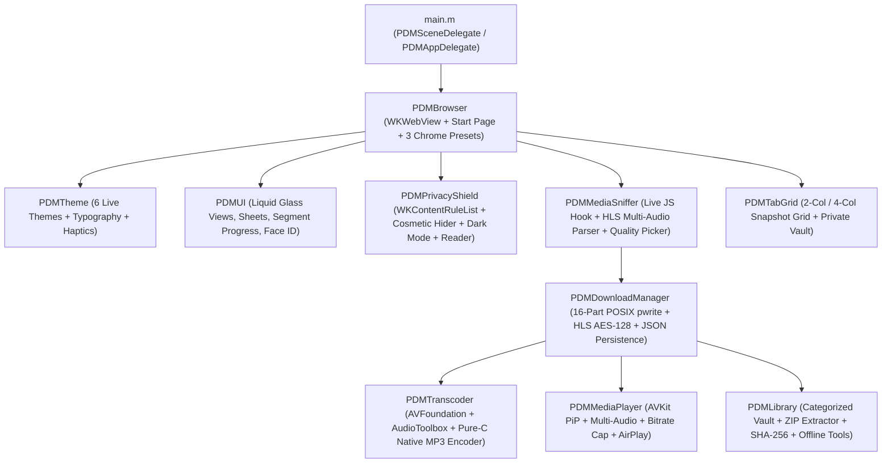

<div align="center">


# PrismDM Browser

**The Flagship Native iOS 26 Liquid Glass Browser & 16-Part IDM Download Manager**

*Pure Native Objective-C · Zero External Dependencies · Multi-Audio HLS Studio · Brave-Style Shields*

[](https://developer.apple.com)
[](src/main.m)
[](src/PDMTheme.m)
[](src/PDMDownloadManager.m)
[](LICENSE)

</div>

---

## Flagship Highlights

**PrismDM Browser** fuses a privacy-hardened, thumb-friendly **iOS 26 Liquid Glass** web browser with a desktop-class **IDM / 1DM multi-segment parallel download manager**, real-time **HLS multi-audio & quality sniffer**, **automatic post-download hardware transcoder + native MP3 encoder**, and a **Pro Picture-in-Picture Media Player** — all engineered in 100% pure native Objective-C with zero third-party libraries.

| Capability | PrismDM Browser | Stock Mobile Browsers |
| :--- | :---: | :---: |
| **16-Part Parallel POSIX `pwrite` Download Engine** | ✅ Up to 16 Segments + Pause/Resume Across Restarts | ❌ Single-Stream Only |
| **Refresh Expired Download Address** | ✅ Keep `.pdmpart` Progress | ❌ Restart from 0% |
| **Live HLS / Video / Audio Media Sniffer** | ✅ Glowing `Media (N)` Pill + Captured Cookies/Referer | ❌ None |
| **Bespoke Quality & Multi-Audio Track Picker** | ✅ `4K–360p` + Language Tracks + Bitrate Selector | ❌ None |
| **Automatic Post-Download Format Converter** | ✅ MP4 (H.264/HEVC), MOV, M4V, MP3, M4A, FLAC, WAV | ❌ None |
| **Brave-Style Native Privacy Shields** | ✅ `WKContentRuleList` + Cosmetic Hider + Popup Blocker | ⚠️ Basic Only |
| **6 Live Liquid Glass Themes + 3 Chrome Presets** | ✅ Zero-Restart Live Switch (`Liquid Glass`, `OLED`, `Ember`...) | ❌ Light / Dark Only |
| **Pro Media Player (Multi-Audio, Quality, PiP)** | ✅ Live Audio Track Switch, Bitrate Cap, AirPlay, Lock Screen | ⚠️ Basic Video Tag |
| **Face ID–Locked Private Tabs & Downloads Vault** | ✅ Non-Persistent `WKWebsiteDataStore` + Biometric Vault | ⚠️ Partial |
| **Offline File Tools (ZIP, SHA-256, Compress)** | ✅ Built-in Native `zlib` Unzip & `CC_SHA256` Verifier | ❌ External Apps Needed |

---

## Visual Design System

### 6 Live-Switchable Liquid Glass Themes
Switch themes instantaneously with zero restart:
1. **Liquid Glass (Default)** — Frosted prism glass, luminous `0.75pt` specular borders, sapphire-cyan highlights.
2. **Obsidian OLED** — True `#000000` pitch-black glass cards with crisp cobalt accents for maximum battery life.
3. **Brave Ember** — Deep charcoal glass paired with warm ember-orange & crimson shields.
4. **Chrome Minimal** — Ultra-clean adaptive pure light / dark minimalist capsule chrome.
5. **Arctic Glacier** — Airy icy frosted glass with crystal glacier-blue highlights.
6. **Cyber Midnight** — Deep midnight-indigo glass with electric violet & neon teal accents.

### 3 Live Chrome Layout Presets
- **Liquid Floating Bottom Bar (Default)** — Edge-to-edge web canvas with auto-hiding thumb-friendly floating glass capsule.
- **Chrome Minimal Top Bar** — Clean single top glass omnibar paired with a slim bottom navigation strip.
- **Compact Power Bar** — High-density Liquid Glass command bar exposing Back, Forward, Shield counter, Omnibar, Media Grabber, Tabs, and Downloads at a glance.

---

## Architecture Overview



### Source Modules

| Module | Responsibility |
| :--- | :--- |
| [`src/main.m`](src/main.m) | Modern iOS 26 `UIWindowScene` lifecycle, background audio session bootstrap, exit cleanup |
| [`src/PDMTheme.h`](src/PDMTheme.h) / [`.m`](src/PDMTheme.m) | 6 Liquid Glass themes, 3 layout presets, 6 search engines, typography, haptics, formatters |
| [`src/PDMUI.h`](src/PDMUI.h) / [`.m`](src/PDMUI.m) | `PDMGlassView`, `PDMGlassPillButton`, `PDMGlassChip`, `PDMSegmentProgressView`, custom Liquid Glass bottom sheets, `PDMBiometricGuard` |
| [`src/PDMPrivacyShield.h`](src/PDMPrivacyShield.h) / [`.m`](src/PDMPrivacyShield.m) | Native `WKContentRuleList` ad/tracker/3p-script blocker, cosmetic cookie/ad hider, Force Dark Mode, Reader extraction, Per-Site Shields sheet |
| [`src/PDMMediaSniffer.h`](src/PDMMediaSniffer.h) / [`.m`](src/PDMMediaSniffer.m) | Real-time JS media sniffer, HLS `#EXT-X-MEDIA` / `#EXT-X-STREAM-INF` multi-audio parser, Quality/Audio/Format Studio sheet, Page Resource Grabber |
| [`src/PDMTranscoder.h`](src/PDMTranscoder.h) / [`.m`](src/PDMTranscoder.m) | Hardware-accelerated `AVFoundation` + `AudioToolbox` converter, proprietary pure-C ISO/IEC 11172-3 MP3 encoder, HLS muxer, `CommonCrypto` AES-128 decryptor |
| [`src/PDMDownloadManager.h`](src/PDMDownloadManager.h) / [`.m`](src/PDMDownloadManager.m) | Multi-segment POSIX `pwrite` parallel downloader, speed cap, Wi-Fi guard, pause/resume/refresh address, zero-idle-drain telemetry, Liquid Glass Download Manager UI |
| [`src/PDMMediaPlayer.h`](src/PDMMediaPlayer.h) / [`.m`](src/PDMMediaPlayer.m) | Built-in Pro Player with live Multi-Audio track switcher, HLS quality switcher, captions, PiP, Lock Screen Now Playing, gestures, AirPlay |
| [`src/PDMLibrary.h`](src/PDMLibrary.h) / [`.m`](src/PDMLibrary.m) | Categorized Offline Library, Face ID Private Vault, built-in `zlib` `.zip` extractor, `CC_SHA256` checksum verifier, offline conversion & audio extraction |
| [`src/PDMTabGrid.h`](src/PDMTabGrid.h) / [`.m`](src/PDMTabGrid.m) | Live `WKWebView` snapshot card grid (2-col iPhone / 4-col iPad), tab search, Reopen Last Closed, Face ID–locked Private segment |
| [`src/PDMBrowser.h`](src/PDMBrowser.h) / [`.m`](src/PDMBrowser.m) | Speed Dial Start Page, live privacy telemetry card, Find in Page, Reader Mode, Bookmarks JSON export/import, History, Save PDF, Settings Studio |

---

## Building via GitHub Actions (Xcode 26)

PrismDM Browser builds cleanly as an unsigned `PrismDM.ipa` with zero external dependencies using strict Xcode 26 compiler flags:

```bash
-fobjc-arc -fmodules -arch arm64 -miphoneos-version-min=26.0 -Wall -Wextra -Werror -O2
```

### Automated Cloud Build
1. Push this repository to your private GitHub repository.
2. Open the **Actions** tab and run **Build PrismDM IPA (iOS 26)** (`.github/workflows/build-ipa.yml`).
3. The workflow runs `tests/run_all_tests.sh` (static verification + strict compile check) followed by `./build.sh`, then uploads **`PrismDM.ipa`** as a downloadable build artifact.

### Local macOS Build (Xcode 26)
```bash
chmod +x build.sh tests/run_all_tests.sh
./tests/run_all_tests.sh
./build.sh
```
Output package: `./PrismDM.ipa`

---

## Installation & Sideloading Guide

Because `PrismDM.ipa` is produced unsigned, install it on iOS 26 devices using your preferred signing tool:

- **AltStore / SideStore:** Import `PrismDM.ipa` directly from Files → AltStore/SideStore signs with your Apple ID and installs.
- **LiveContainer:** Import `PrismDM.ipa` into LiveContainer to run natively without consuming an active app ID slot.
- **TrollStore:** Share `PrismDM.ipa` to TrollStore for permanent CoreTrust-signed installation.
- **Xcode:** Sign `build/PrismDM.app` via `codesign` or an Xcode signing profile and deploy directly to your connected iPhone/iPad.

---

## Proprietary License Notice

> **STRICTLY CLOSED-SOURCE · ALL RIGHTS RESERVED**
>
> Copyright © 2026 PrismDM. All Rights Reserved.
> This project is **proprietary software** and is **NOT open source**. Unauthorized copying, redistribution, modification, derivative works, reverse engineering, or commercial use is strictly prohibited without prior written permission from the copyright owner. See [`LICENSE`](LICENSE) for complete legal terms.
